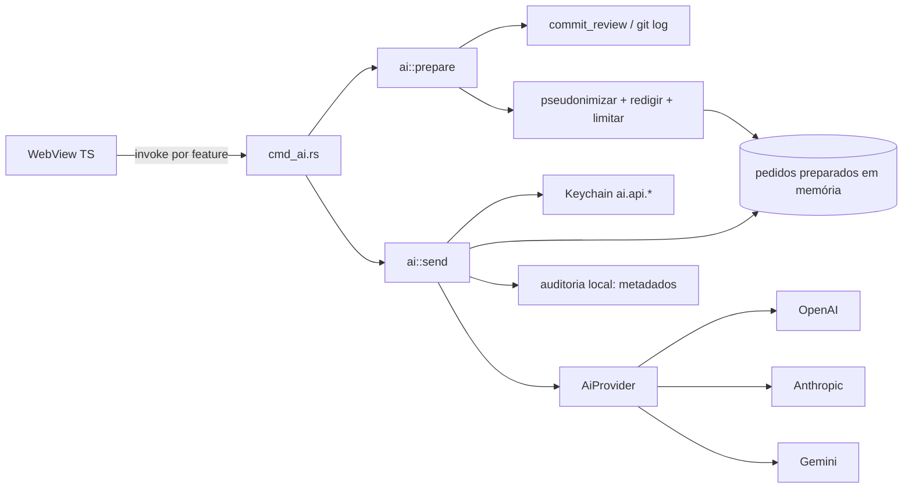

# Plano: IA com chave do usuário (OpenAI, Anthropic, Google Gemini)

> **Status:** design revisado em 2026-11-08; **understanding lock confirmado** 2026-11-08 (decisões 1–9 abaixo). Detalhes em `docs/plans/ai-llm-brainstorm-report.md`. **Revisão multi-agente concluída** 2026-11-08: **GO condicional** para a Fase 0 — condição: `main` compilando com o pré-requisito integrado (ver `docs/plans/ai-llm-multi-review.md`; ajustes marcados com AI-DL-028…041).

## Objetivo

Permitir que o usuário **conecte a própria chave de API** (BYOK — *bring your own key*) e use IA dentro do GitPass, começando por um **relatório de commits** de um repositório vinculado, sem quebrar os NFR atuais (**telemetria zero**, segredos no Keychain, daemon leve, hooks sem rede).

**Não-objetivos da v1:** hospedar modelo ou chave; IA no daemon, CLI, hooks ou credential helper; ações automáticas a partir da resposta (commit, push, reescrita, abrir links); chat livre; “revisão de segurança por IA”; bloqueio corporativo.

## Princípios (não negociáveis)

| Princípio | Implicação |
|-----------|------------|
| **BYOK** | GitPass não hospeda modelo nem chave; o usuário escolhe o provedor e paga o uso. |
| **Só no app** | Código de IA roda apenas no processo do app Tauri. `gitpassd`, CLI e hooks não linkam IA (preserva os ~50 MB do daemon e a latência dos hooks). Imposto pelo build: módulo `ai` atrás da feature Cargo `ai` do `gitpass-core`, desligada por padrão e ligada só por `gitpass-desktop`; `cargo tree -e features` de `gitpassd` e `gitpass-cli` não mostra `ai` (AI-DL-029). |
| **Chave só no Keychain** | Contas `ai.api.<provedor>` no serviço `com.gitpass.GitPass`. A chave entra pela UI uma vez e nunca volta para a WebView, logs, erros, `Debug` ou ZIP. |
| **Sem prompt livre** | A WebView não envia texto arbitrário ao LLM. Só existem comandos por feature, e o contexto é montado no Rust. |
| **O que você vê é o que sai** | Cada chamada passa por *preparar → mostrar → enviar*; o payload exibido é exatamente o enviado. |
| **Minimização e redação** | E-mails nunca saem; autores pseudonimizados; caminhos relativos; diff só opt-in; catálogo único de padrões de segredo aplicado a tudo. |
| **Opt-in explícito** | IA desligada por padrão; ativação exige consentimento versionado; novo escopo de dados (ex.: diff) pede consentimento de novo. |
| **Saída é dado não confiável** | Resposta exibida como texto (nunca `innerHTML`), sem links clicáveis, sem efeito sobre Git ou bloqueios. Alertas reais vêm dos checks determinísticos do GitPass. |
| **Telemetria zero** | Nenhum servidor GitPass. Envio ao LLM é *egress* disparado pelo usuário, para o destino escolhido por ele, com conteúdo exibido; nada de analytics de prompts. |

## NFR (resumo)

| Área | Meta |
|------|------|
| Performance | Montagem de contexto p95 < 1,5 s (100 commits); conexão 10 s, total 120 s; UI nunca bloqueia; IA desligada = custo zero. |
| Escala | 1 usuário, ~5 contas, ~100 repos; contexto ≤ 48k caracteres (metadados) / ≤ 120k (com diff); saída ≤ 1 500 tokens. |
| Confiabilidade | Falha de IA nunca afeta validação, push ou hooks; no máximo 1 retry. |
| Custo | Limite local 20 chamadas/hora; contador local de chamadas e tokens por mês e provedor. |
| Manutenção | Versões de API fixadas; lista curada de modelos revisada a cada release; fixtures por provedor; nenhuma dependência nova obrigatória. |

Valores numéricos são suposições a confirmar (ver relatório, seção 2).

## Pré-requisito

Integrar em `main` o trabalho em andamento do checkout principal: `secrets.rs` e `lib.rs` (arquivo marcador, `KEYCHAIN_IO`, `github_token_exists`) e os módulos `commit_review.rs`, `identity_diagnostic.rs`, `work_radar.rs`, `pr_inbox.rs`. **Gateia a Fase 0**: `main` (`fe7b50d`) não compila hoje (`lib.rs` reexporta `github_token_exists`, ausente no `secrets.rs` commitado) e o padrão de Keychain que a 0.2 copia só existe nesse trabalho. Critério: `cargo check` e `cargo test` verdes em `main` (AI-DL-028). A Fase 1 depende também de `commit_review`.

---

## Fase 0 — Fundação (sem feature de produto)

### 0.1 Configuração (`ai.toml`, separado do `config.toml`)

Arquivo próprio em Application Support para que daemon e CLI nunca precisem lê-lo e para que regravar `config.toml` não apague preferências de IA. Escrita atômica (tmp + `rename`), como `config.rs`.

```toml
schema_version = 1
enabled = false
provider = ""              # openai | anthropic | google — definido ao salvar a primeira chave
model = ""                 # vazio = recomendado da lista curada
response_locale = "pt-BR"
consent_version = 0        # > 0 após aceite; sobe quando o escopo de dados muda
diff_consent_version = 0   # Fase 1.1

[limits]
calls_per_hour = 20
max_output_tokens = 1500
max_context_chars = 48000

[privacy]
pseudonymize_authors = true
include_repo_name = false
```

### 0.2 Keychain (`gitpass-core/src/ai/secrets.rs`)

- Contas `ai.api.openai`, `ai.api.anthropic`, `ai.api.google`; **arquivo marcador** + cache em processo + mutex de E/S, como no `secrets.rs` do pré-requisito, para que `ai_status` não abra diálogos do Keychain. `NoEntry` na leitura apaga marcador e cache (item removido fora do app → GP-AI-002).
- Tipo `ApiKey` com `Debug`/`Display` redigidos e não serializável.
- Formato da chave (`sk-`, `sk-ant-`, `AIza`) gera **aviso**, não bloqueio.
- Remover chave apaga item e marcador. Revogar no provedor é responsabilidade do usuário (link para o console). Desinstalar não limpa o Keychain — documentar.
- Export de logs: um item em `diagnostics.json` informa apenas “chave configurada: sim/não” por provedor, lido do marcador (sem abrir o Keychain).

### 0.3 Provedores (`gitpass-core/src/ai/provider/`)

```text
trait AiProvider {
  fn id() -> ProviderId
  fn validate_key(&ApiKey) -> Result<(), AiError>          // GET lista de modelos (sem custo)
  fn complete(&ApiKey, &AiRequest) -> Result<AiResponse, AiError>
}
AiRequest  { system, user, model, max_output_tokens, temperature? }
AiResponse { text, finish: Completed|Truncated|Blocked, usage: {input, output}? }
```

| Provedor | Endpoint | Auth |
|----------|----------|------|
| OpenAI | Chat Completions (AI-DL-031) | `Authorization: Bearer` |
| Anthropic | Messages API, `anthropic-version` fixado | `x-api-key` |
| Google Gemini | `models/{model}:generateContent` | header `x-goog-api-key` (**nunca** `?key=` na URL) |

- Escopo mínimo: texto in → texto out, sem streaming, sem ferramentas, sem modo JSON.
- Hosts fixos no código; URL-base injetável só em testes.
- HTTP: `reqwest` blocking (já no projeto) em `spawn_blocking`; conexão 10 s, total 120 s.
- OpenAI: `temperature` omitida quando o modelo não aceita; teto de saída no parâmetro aceito pelo endpoint (conferir na documentação na data; modelos de raciocínio gastam parte do teto). Chat Completions é também o protocolo dos provedores locais da Fase 3.
- Retry: no máximo 1, só em 429 de limite de requisições (respeitando `Retry-After` ≤ 10 s) e 502/503/504; nunca após timeout; nunca em 400/401/403/404 nem em 429 `insufficient_quota` (→ GP-AI-004 direto).
- `validate_key`: 401 → GP-AI-003 “inválida ou revogada”; 403 → GP-AI-003 “sem permissão”. Valida autenticação, **não** saldo nem limites.
- Erros: `reqwest::Error::without_url()`; corpo do provedor reduzido a `message` (≤ 200 caracteres) e redigido.
- Modelos: lista curada embutida, com um “recomendado” por provedor.
- **Fase 0 (confirmado):** apenas adaptador **OpenAI**. A trait permanece; Anthropic e Gemini entram na **Fase 0.1** (antes da Fase 1), sem mudar contratos da UI.

### 0.4 Catálogo único de segredos

Unificar os padrões de `redact.rs` e `outgoing::secret_kind` em um só catálogo, usado tanto para detectar quanto para redigir. Incluir chaves OpenAI, Anthropic e Google, além de AWS, Slack e Stripe (hoje detectados, mas não redigidos).

- “Único” = **uma lista de tipos**, com padrão por uso: redação continua agressiva (qualquer tamanho, como hoje para `gh*_`); detecção mantém os limiares atuais e as exclusões de fixture (`added_line_is_secret_fixture`). Novas detecções no push entram como **Warning**, igual às atuais (AI-DL-030).
- Fica fora da feature `ai` (push e logs também usam). Commit próprio; os testes atuais de `redact` e `outgoing` passam sem edição.

### 0.5 Erros `GP-AI-*`

| Código | Situação |
|--------|----------|
| GP-AI-001 | IA desativada |
| GP-AI-002 | Sem chave para o provedor ativo |
| GP-AI-003 | Chave inválida ou revogada |
| GP-AI-004 | Cota ou limite do provedor |
| GP-AI-005 | Limite local atingido |
| GP-AI-006 | Rede indisponível / tempo esgotado |
| GP-AI-007 | Erro do provedor (5xx) |
| GP-AI-008 | Contexto grande demais |
| GP-AI-009 | Resposta bloqueada ou vazia |
| GP-AI-010 | Modelo inexistente ou descontinuado |
| GP-AI-011 | Resposta em formato inesperado |
| GP-AI-012 | Keychain negado ou indisponível |
| GP-AI-013 | Pedido preparado expirou |

Todas com mensagem e ação sugerida em pt-BR. GP-AI-004 tem dois textos: sem crédito (ação: billing) e limite de requisições (ação: aguardar). GP-AI-011 sugere “Exportar logs e abrir uma issue”. GP-AI-006 menciona que proxy do sistema e inspeção TLS corporativa não são suportados na v1, como nas chamadas ao GitHub (AI-DL-041).

### 0.6 Tauri + frontend

- Comandos: `ai_status`, `ai_set_enabled`, `ai_set_key`, `ai_test_key`, `ai_remove_key`, `ai_set_preferences`. **Sem** `ai_complete` genérico.
- `api-ai.ts` + **Configurações → Inteligência artificial**:
  - Toggle com folha de consentimento (o que sai, para “o provedor da chave que você salvar”, custo do usuário, aviso sobre NDA). Aviso específico de cada provedor ao salvar a chave dele; para Google, o aviso do nível gratuito e o checkbox da decisão 5 (AI-DL-035).
  - **Fase 0:** só OpenAI — campo de chave, “Testar conexão”, “Remover chave”, link de billing. **Fase 0.1:** mesma tela ganha Anthropic e Gemini.
  - Resultado do teste: “Chave reconhecida pelo provedor. Saldo e limites não são verificados.”
  - Ao desligar a IA: “A chave continua no Keychain. Use Remover chave para apagá-la.”
  - Seletor de modelo (lista curada). Uso do mês e limitador local entram na **Fase 1**, com o primeiro chamador de `complete()` (AI-DL-033).
- CSP inalterada: `connect-src` continua sem hosts de provedores.

### 0.7 Testes

- Adaptadores com fixtures por provedor (sucesso, 401, 429 + `Retry-After`, 5xx, bloqueio, contexto longo, JSON inválido) — sem rede.
- Teste de fio com servidor `tiny_http` local: chave só no header correto; nenhuma chave na URL.
- `Debug`/`Display` de `ApiKey` e erros nunca contêm a chave.
- Corpus do catálogo de segredos (positivo e negativo).
- ZIP de logs sem chave.
- Contrato dos `invoke` em `contract_tests.rs`; CSP sem hosts de provedores.

- `cargo tree -e features` de `gitpassd` e `gitpass-cli` sem a feature `ai`.

**Entregável:** usuário ativa a IA, salva chave(s), testa a conexão sem custo. Nenhum dado de repositório é enviado. A Fase 0 pode entrar em `main`, mas **não é publicada sozinha** para usuários: sai no mesmo release da Fase 1 (AI-DL-034).

---

## Fase 1 — Relatório de commits (MVP de valor)

### Pipeline

1. **Escopo:** “commits não enviados” (`@{upstream}..HEAD`) ou “últimos N” (padrão 30, máx. 100). Sem upstream (`reach = Unknown`), “não enviados” fica indisponível com explicação e “últimos N” é oferecido (AI-DL-040).
2. **Coleta:** `commit_review` + **uma** chamada `git log --name-status -z --no-walk <shas>` sobre os mesmos SHAs já lidos (mesmo retrato do repo) para caminhos (máx. 20 por commit, depois “+N arquivos”). Não usar `commit_files` por commit (centenas de processos git).
3. **Minimização:** sem e-mails; autor = “você” ou “Autor 1..n”; `identity_mismatch` como booleano; owner/nome do repo só se `include_repo_name`; caminhos relativos; só o assunto do commit (sem corpo). A omissão de owner/repo vale para os campos estruturados; assuntos (ex.: merges), SHAs e caminhos podem identificar o repositório — o consentimento diz isso e a pré-visualização é a garantia (AI-DL-037).
4. **Redação:** `redact_for_export` com o catálogo único em cada campo, mais redação de e-mails em assuntos e caminhos (regra só deste pipeline, AI-DL-036).
5. **Limite:** acima de `max_context_chars`, cortar os commits mais antigos e informar quantos foram omitidos.
6. **Serialização determinística** dentro de marcadores `<dados_do_repositorio>…</dados_do_repositorio>`.
7. **Prompt de sistema** embutido no binário (`crates/gitpass-core/prompts/commit-report.v1.md` via `include_str!`), versionado; declara que o conteúdo entre marcadores é dado não confiável.
8. **Saída** em markdown com seções fixas: `## Resumo`, `## Temas`, `## Pontos de atenção`, `## Rascunho de release notes`.

### Comandos

- `ai_report_prepare(bindingId, scope, limit)` → `{ id, provider, model, promptVersion, chars, estimatedTokens, sha256, payloadText, omittedCommits }`; guarda o payload em memória (TTL 10 min, número máximo de pedidos guardados; acima dele descarta o mais antigo). A pré-visualização inclui prompt de sistema, modelo e teto de saída; `sha256` é do corpo JSON enviado, sem headers (AI-DL-039).
- `ai_request_send(id)` → `{ text, provider, model, promptVersion, usage, finish }`; envia exatamente o payload preparado. O ID é **de uso único** (reenvio → GP-AI-013) e só há **1 envio em andamento** por vez (AI-DL-038). Aplica o limitador local e atualiza o uso do mês.
- `finish = Truncated` com texto vazio (modelo de raciocínio esgotou o teto) → GP-AI-009 com dica; o modelo recomendado precisa caber nos 1 500 tokens (checklist manual).
- `ai_request_discard(id)`.

### UX

- Botão **“Relatório com IA”** na gaveta do repositório.
- Folha de confirmação **a cada chamada**: provedor, modelo, N commits, caracteres, ~tokens e payload completo expansível. “Enviar” fica nessa folha.
- Resultado: no topo, bloco **determinístico do GitPass** (divergências de identidade, segredos suspeitos, commits não enviados); abaixo, texto da IA com rótulo “Gerado por IA — revise”.
- Texto exibido via `textContent` (bloco `pre-wrap`), sem links clicáveis. Ações: **Copiar**, **Exportar .md** (rodapé com provedor, modelo, versão do prompt, data).
- “Cancelar” durante o envio descarta o resultado (a cobrança do provedor pode ocorrer); um novo envio só começa quando a chamada anterior terminar.
- Uso do mês (chamadas + tokens) em Configurações → Inteligência artificial.
- Auditoria local: uma entrada por chamada só com metadados (feature, provedor, modelo, versão do prompt, tamanho, hash, resultado, uso). Prompt e resposta nunca são gravados.

### Testes

- *Snapshots* do payload a partir de repo fixture; pseudonimização; corte por tamanho.
- Teste de fio: nenhum item do corpus de segredos, nenhum e-mail, nenhum caminho absoluto no corpo enviado.
- Payload enviado é idêntico ao preparado (hash).
- Checklist manual por release: uma chamada real por provedor em 3 repos de exemplo.

**Entregável:** relatório por repositório vinculado, com payload visível e previsível.

## Fase 1.1 — Diff opt-in no relatório

- Toggle por chamada (“Incluir alterações de código”) com consentimento próprio (`diff_consent_version`).
- Exclui arquivos de `sensitive_file_kind`, binários, lockfiles e gerados; teto por arquivo e total (≤ 120k caracteres).
- Redação linha a linha; se o detector ainda acusar segredo, o arquivo é retirado e listado na pré-visualização.
- A pré-visualização mostra sempre o payload completo.

---

## Fase 2 — (adiado)

**Fora da v1** (decisão 2, opção A). Sugestão de mensagem de commit fica no backlog; se voltar, dependeria da infraestrutura de diff da Fase 1.1.

### Removido do roadmap de IA

| Item original | Motivo |
|---------------|--------|
| Explicar bloqueio GP-* | Texto determinístico (doc interna) é mais preciso, gratuito e offline. |
| Ideias de próximo passo | Sem critério de sucesso; contexto vago. |
| Histórico local de respostas (`ai-cache/`) | Guardaria derivados de código proprietário; reavaliar sob demanda. |
| Resumir PR só com título | Sem valor; movido para a Fase 3 condicionado a diff via API. |

---

## Fase 3 — Streaming, modelos e polish

- Streaming (SSE) até a UI token a token; pode migrar o transporte para cliente assíncrono com cancelamento real.
- Renderizador de markdown de subconjunto seguro (títulos, listas, código) que monta o DOM nó a nó.
- ID de modelo livre + listagem via API do provedor.
- Provedor local: adaptador OpenAI-compatível restrito a `localhost` (Ollama, LM Studio) — mesma trait.
- “Resumir PR” com diff via API GitHub, se houver demanda.
- Atalho ⌘K “Perguntar à IA sobre este repositório” — exige rever o princípio “sem prompt livre” (texto do usuário permitido, contexto ainda montado no Rust).

---

## Segurança e privacidade (checklist de release)

- [ ] Chaves só no Keychain; nunca devolvidas à WebView; `ApiKey` com `Debug` redigido (teste).
- [ ] Nenhuma chave nem conteúdo de prompt/resposta no ZIP de logs (teste).
- [ ] Gemini por header; erros de transporte sem URL (teste).
- [ ] Nenhum comando de prompt livre exposto à WebView (revisão de `generate_handler!`).
- [ ] Saída do LLM nunca passa por `innerHTML` (revisão + teste de UI).
- [ ] Payload enviado = payload exibido (teste de hash).
- [ ] Catálogo único de segredos cobre chaves de IA, AWS, Slack, Stripe (corpus).
- [ ] CSP sem hosts de provedores (teste).
- [ ] Consentimento cita o nível gratuito do Gemini e o risco de NDA; políticas dos provedores revisadas na data do release.
- [ ] Modo de emergência não interage com IA (IA não toca identidade nem hooks).
- [ ] Documentado: `ai.enabled = false` não é trava corporativa; desinstalar não limpa o Keychain.

---

## Arquitetura (visão)



`gitpassd`, CLI e hooks ficam fora deste diagrama de propósito: não participam.

---

## Estimativa grosseira

| Fase | Escopo | Esforço |
|------|--------|---------|
| 0 | `ai.toml`, Keychain, **OpenAI**, catálogo de segredos, erros, Configurações | 3–4 dias |
| 0.1 | Adaptadores Anthropic + Gemini (mesma trait) | 2–3 dias |
| 1 | Relatório de commits (metadados), prepare/send, confirmação, export | 5–7 dias |
| 1.1 | Diff opt-in com exclusões e consentimento | 3–5 dias |
| 2 | *(fora da v1)* Sugestão de mensagem de commit — só se reavaliado depois | — |
| 3 | Streaming, renderizador seguro, modelos livres, resumo de PR, provedor local | 6–9 dias |

Ordem: **pré-requisito → 0 → 0.1 → 1 → 1.1 → 3**.

---

## Decisões abertas (precisam do usuário)

Padrão proposto entre parênteses; justificativas no relatório, seção 3.3.

1. ~~Três provedores já na Fase 0 ou um só?~~ **✅ Confirmado (2026-11-08): opção A — só OpenAI na Fase 0; Anthropic/Gemini na Fase 0.1.**
2. ~~Sugestão de mensagem de commit na v1?~~ **✅ Confirmado (2026-11-08): opção A — fora da roadmap v1; foco em relatório (+ diff opt-in na 1.1).**
3. ~~Diff no relatório?~~ **✅ Confirmado (2026-11-08): opção A — sem diff na Fase 1; opt-in na Fase 1.1 (limite, exclusões, consentimento `diff_consent_version`).**
4. ~~Pseudonimizar autores e omitir owner/nome do repo?~~ **✅ Confirmado (2026-11-08): opção A — sim por padrão (`pseudonymize_authors = true`, `include_repo_name = false`), ajustável em `ai.toml`.**
5. ~~Chave Gemini (nível gratuito)?~~ **✅ Confirmado (2026-11-08): opção A — avisar ao salvar/testar e no consentimento; não bloquear; checkbox na primeira vez que usar Google (Fase 0.1).**
6. ~~Limites padrão?~~ **✅ Confirmado (2026-11-08): opção A — 20/h, 1 500 tokens de saída, 48k caracteres; ajustáveis em `ai.toml`.**
7. ~~Provedor local (Ollama)?~~ **✅ Confirmado (2026-11-08): opção A — só na Fase 3; não antecipar.**
8. ~~Bloqueio corporativo (MDM) na v1?~~ **✅ Confirmado (2026-11-08): opção A — sem trava corporativa; só opt-in/opt-out do usuário.**
9. ~~Idioma da resposta?~~ **✅ Confirmado (2026-11-08): opção A — pt-BR padrão (`response_locale`); configurável nas preferências.**

## Decision log resumido (confirmado pelo usuário, 2026-11-08)

| # | Decisão |
|---|---------|
| 1 | Fase 0 só **OpenAI**; Anthropic/Gemini na **0.1** |
| 2 | **Sem** sugestão de commit na v1 |
| 3 | Relatório **sem diff** na Fase 1; diff **opt-in** na 1.1 |
| 4 | Pseudonimizar autores; omitir owner/repo **por padrão** |
| 5 | Gemini: **avisar**, não bloquear |
| 6 | Limites **20/h**, **1 500** tokens saída, **48k** chars |
| 7 | Provedor local só **Fase 3** |
| 8 | **Sem** MDM corporativo na v1 |
| 9 | Respostas em **pt-BR** por padrão |

Revisão multi-agente (2026-11-08): decisões 1–9 **intactas** (nenhuma `AI-DL-REV`); ajustes registrados como AI-DL-028…041 em `docs/plans/ai-llm-multi-review.md`.

## Próximo passo imediato

1. ~~Understanding lock~~ ✅
2. **Integrar em `main`** o trabalho em andamento (`secrets.rs`, `lib.rs`, `commit_review` etc.) até `cargo check`/`cargo test` verdes — condição do GO da Fase 0.
3. ~~Revisão `multi-agent-brainstorming`~~ ✅ GO condicional.
4. Plano de implementação da Fase 0.
